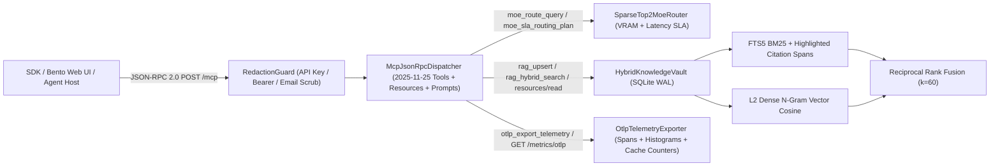

# mcp-moe-hybrid-sdk

[](LICENSE)
[](https://modelcontextprotocol.io/specification/2025-11-25)
[](pyproject.toml)

Production-grade, zero-bloat Python AI SDK & Full-Stack Server uniting **Model Context Protocol (`MCP 2025-11-25` Tools, Resources & Prompts over JSON-RPC 2.0)**, **Hardware- & SLA-Aware Sparse Top-2 Mixture-of-Experts (`MoE`) Query Routing**, **SQLite `WAL` + `FTS5` BM25 Highlighted Citation Spans + Cosine Vector Reciprocal Rank Fusion (`RRF`) Hybrid RAG**, **OpenTelemetry (`OTLP/JSON`) Span & Histogram Export**, and **Deterministic Secret/PII Redaction**.

---

## System Architecture



---

## Empirical Golden-Suite Benchmarks (`benchmarks/run_golden_eval.py`)

| Subsystem | Golden Queries | Accuracy / Recall@1 | $p_{50}$ Latency | $p_{95}$ Latency | External Runtime Dependencies |
| :--- | ---: | ---: | ---: | ---: | :--- |
| **Hybrid RAG (`FTS5 BM25 + Vector RRF`)** | `100` | **`1.0000` (`100%`)** | **`0.2795 ms`** | **`0.4660 ms`** | `0` (Stdlib `sqlite3` `WAL` + `FTS5`) |
| **Sparse Top-2 MoE Router (`4` Tiers)** | `100` | **`1.0000` (`100%`)** | **`0.0087 ms`** | **`0.0122 ms`** | `0` (Deterministic math + SLA guard) |

---

## Quickstart

### 1. Local Install & Test Gate
```bash
pip install -e .
python -m unittest discover -s tests -v
python benchmarks/run_golden_eval.py
```

### 2. Launch Full-Stack MCP Server + Interactive Bento Web Showcase
```bash
python -m mcp_moe_sdk.server
# Open http://127.0.0.1:8090 for the interactive UI or query GET /health & POST /mcp
```

### 3. Containerized Deployment
```bash
docker build -t mcp-moe-hybrid-sdk:1.2.0 .
docker run --rm -p 8090:8090 mcp-moe-hybrid-sdk:1.2.0
```

---

## Python SDK Usage

```python
from mcp_moe_sdk import HybridKnowledgeVault, McpJsonRpcDispatcher, SparseTop2MoeRouter

vault = HybridKnowledgeVault(":memory:")
vault.upsert(
    doc_id="rfc-01",
    title="SQLite WAL FTS5 + Dense Vector RRF",
    body="Fuses exact BM25 keyword matches with cosine similarity.",
    tags=["rag", "sqlite", "fts5"],
)

router = SparseTop2MoeRouter()
decision = router.route(
    "Prove Black-Scholes convexity theorem and MoE invariant",
    max_vram_gib=6.0,
    latency_sla_ms=1200.0,
)
print(decision["selected_tier"], decision["top2_sparse_gates"])

mcp = McpJsonRpcDispatcher(vault=vault, router=router)
resp = mcp.handle({
    "jsonrpc": "2.0",
    "id": 1,
    "method": "tools/call",
    "params": {"name": "rag_hybrid_search", "arguments": {"query": "BM25 cosine RRF", "top_k": 3}},
})
```

---

## License

Released under the [MIT License](LICENSE).
