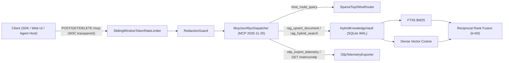

# mcp-moe-hybrid-sdk

[](LICENSE)
[](https://modelcontextprotocol.io/specification/2025-11-25)
[](pyproject.toml)

A Python SDK and HTTP server with zero external runtime dependencies, uniting an **MCP `2025-11-25` Streamable JSON-RPC 2.0 server**, a **hardware and SLA aware Sparse Top-2 MoE router**, and an **embedded SQLite WAL (`FTS5` BM25 + dense vector cosine RRF) Hybrid RAG engine**. Built for local evaluation, governance enforcement, and single-container deployment without external vector databases or API keys.

---

## Problem Solved

- **Zero External Runtime Dependencies**: Runs entirely on Python 3.10+ stdlib and embedded SQLite `WAL`/`FTS5` with no external vector DB, Redis, or orchestration cluster required.
- **VRAM & Latency SLA Routing**: Routes prompts across 4 expert tiers (`edge_fast_json`, `rag_grounded_synthesis`, `code_and_systems_verifier`, `frontier_moe_math_architect`) under configurable VRAM and latency budgets.
- **Built-In Production Governance**: Enforces secret and PII redaction (`RedactionGuard`), sliding-window request/token rate limiting (`X-RateLimit-*`, HTTP `429 Retry-After`), W3C `traceparent` + OTLP/JSON telemetry, and MCP `2025-11-25` controls (`OAuthProtectedResourceGuard` RFC 9728 `/.well-known/oauth-protected-resource`, RFC 7636 `PKCE S256`, & RFC 8707/6750 audience-bound `Bearer` introspection, `Mcp-Session-Id` + `Last-Event-ID` SSE replay, `roots/list` `file://` confinement, `elicitation`/`sampling` HITL checks, JSON-Schema 2020-12 `outputSchema` validation, cooperative `notifications/cancelled`).
- **Offline Reproducibility**: Every unit test, protocol check, and golden dataset benchmark runs reproducibly offline with zero external API keys.

---

## Architecture Overview



| Layer | Implementation / Surface | Role |
| :--- | :--- | :--- |
| **Core Engine** | [`src/mcp_moe_sdk/engine.py`](https://github.com/nahianakhtar/mcp-moe-hybrid-sdk/blob/main/src/mcp_moe_sdk/engine.py) | `McpJsonRpcDispatcher`, `SparseTop2MoeRouter`, `HybridKnowledgeVault`, `RedactionGuard`, `SlidingWindowTokenRateLimiter`, `OtlpTelemetryExporter` |
| **HTTP + UI Server** | [`src/mcp_moe_sdk/server.py`](https://github.com/nahianakhtar/mcp-moe-hybrid-sdk/blob/main/src/mcp_moe_sdk/server.py) | `ThreadingHTTPServer` serving `/` (Web UI), `/health`, `/mcp`, `/metrics/otlp`, `/mcp/notifications` |
| **MCP Tools** | `tools/call` | `moe_route_query`, `rag_upsert_document`, `rag_hybrid_search`, `otlp_export_telemetry` |
| **MCP Resources & Prompts** | `resources/list`, `prompts/list` | `mcp://moe-router/tiers`, `mcp://telemetry/otlp`, `mcp://governance/*`, `vault://documents/*`, `grounded_rag_answer`, `moe_sla_routing_plan` |

---

## 30-Second Quickstart

### Local Install & Server

```bash
uv venv --python 3.12 .venv
uv pip install --python .venv/bin/python -e ".[dev]"
.venv/bin/python -m mcp_moe_sdk.server
# Listens on http://127.0.0.1:8090 (override with MCP_HOST / MCP_PORT)
```

### Containerized Deployment

```bash
docker build -t mcp-moe-hybrid-sdk:1.9.0 .
docker run --rm -p 8090:8090 mcp-moe-hybrid-sdk:1.9.0
```

---

## Sample CLI / MCP & Python SDK Usage

### MCP HTTP (`curl`)

```bash
# 1. Health & governance snapshot
curl -s http://127.0.0.1:8090/health

# 2. Initialize MCP 2025-11-25 session (returns Mcp-Session-Id response header)
curl -i -s -X POST http://127.0.0.1:8090/mcp \
  -H "Content-Type: application/json" \
  -d '{"jsonrpc":"2.0","id":1,"method":"initialize","params":{"protocolVersion":"2025-11-25","capabilities":{}}}'

# 3. Call Sparse Top-2 MoE router tool
curl -s -X POST http://127.0.0.1:8090/mcp \
  -H "Content-Type: application/json" \
  -d '{"jsonrpc":"2.0","id":2,"method":"tools/call","params":{"name":"moe_route_query","arguments":{"prompt":"Verify SQLite WAL FTS5 RRF"}}}'

# 4. Call Hybrid RAG search tool
curl -s -X POST http://127.0.0.1:8090/mcp \
  -H "Content-Type: application/json" \
  -d '{"jsonrpc":"2.0","id":3,"method":"tools/call","params":{"name":"rag_hybrid_search","arguments":{"query":"SQLite FTS5 RRF","top_k":3}}}'
```

Additional endpoints: `GET /metrics/otlp` exports OTLP/JSON telemetry, `GET /mcp` with `Mcp-Session-Id` + `Last-Event-ID` replays missed SSE events, and `DELETE /mcp` terminates an active session.

### Python SDK

```python
from mcp_moe_sdk import HybridKnowledgeVault, McpJsonRpcDispatcher, SparseTop2MoeRouter

vault = HybridKnowledgeVault(":memory:")
vault.upsert(
    doc_id="rfc-01",
    title="SQLite WAL FTS5 + Dense Vector RRF",
    body="Fuses exact BM25 keyword matches with cosine similarity.",
    tags=["rag", "sqlite", "fts5"],
)

router = SparseTop2MoeRouter()
decision = router.route(
    "Prove Black-Scholes convexity theorem and MoE invariant",
    max_vram_gib=6.0,
    latency_sla_ms=1200.0,
)
print(decision["selected_tier"], decision["top2_sparse_gates"])

mcp = McpJsonRpcDispatcher(vault=vault, router=router)
resp = mcp.handle({
    "jsonrpc": "2.0",
    "id": 1,
    "method": "tools/call",
    "params": {"name": "rag_hybrid_search", "arguments": {"query": "BM25 cosine RRF", "top_k": 3}},
})
print(resp["result"]["structuredContent"])
```

---

## Verified Test & Benchmark Commands

Run the exact CI and Docker verification commands offline:

```bash
.venv/bin/ruff check .
PYTHONPATH=src .venv/bin/pytest -q
PYTHONPATH=src .venv/bin/python benchmarks/run_golden_eval.py
```

| Check | Scope | Verified Result |
| :--- | :--- | :--- |
| **Lint (`ruff`)** | Full repository | `All checks passed!` |
| **Test Suite (`pytest`)** | Offline unit, protocol & edge-case tests | `42 passed` |
| **Golden Eval (`benchmarks/run_golden_eval.py`)** | `100` RAG queries + `100` MoE routing queries (`0` external deps) | `1.0000` (`100%`) Recall@1 (`0.2396 ms` p50 / `0.3762 ms` p95); `1.0000` (`100%`) Router Accuracy (`0.0081 ms` p50 / `0.0123 ms` p95); latencies vary by hardware |

---

## License

Released under the [MIT License](LICENSE).
